<h1 align="center">Hi 👋, I'm Arjun Hari</h1>

<h3 align="center">Junior Python Full Stack Developer | Software Engineer from India 🇮🇳</h3>

  

 

  
  
  

---

## 👨‍💻 About Me

- 🎓 Computer Science and Engineering Graduate.
- 💻 Interested in Python and Full Stack Development.
- 🐍 Hands-on experience with Python and Django.
- ⚡ Familiar with FastAPI and REST APIs.
- 🤖 Interested in Artificial Intelligence and Machine Learning.
- 👁️ Worked with YOLO and Computer Vision.
- 🌱 Continuously learning and improving my development skills.
- 🎯 Aspiring Software Developer.

📫 **Email:** hariarjun658@gmail.com

🌐 **Portfolio:** Coming Soon

💼 **LinkedIn:** [Arjun Hari](https://www.linkedin.com/in/arjunhari19)

🐙 **GitHub:** [arjunhari004](https://github.com/arjunhari004)

---

## 🚀 Projects

### 🔹 1. AI-Powered Intelligent Surveillance and Post-Disaster Management System

An AI-powered monitoring system designed to identify and analyze natural and human-made hazards.

- Developed a Python-based monitoring system.
- Integrated computer vision and machine learning techniques.
- Implemented automated object detection and incident identification.
- Designed alert mechanisms to support risk assessment and emergency response.

**Technologies:** Python | YOLO | Machine Learning | Computer Vision

### 🔹 2. CrowdNova – Innovation and Brilliance in Crowd Management

An intelligent crowd monitoring system focused on public safety and crowd density analysis.

- Developed a real-time crowd monitoring application.
- Used YOLO object detection for crowd identification.
- Processed video data to analyze crowd density.
- Generated crowd insights to support public safety monitoring.

**Technologies:** Python | YOLO | AI/ML | Computer Vision

---

## 🛠️ Tech Stack & Tools

### Programming Languages

### Frontend Development

### Backend Development

### Database & Development Tools

### AI & Computer Vision

---

## 🎓 Education

**B.Tech in Computer Science and Engineering**

Mahaguru Institute of Technology, Kayamkulam

- CGPA: 8.42
- Graduation: 2026

---

## 🏆 Certifications & Leadership

- 📜 The Complete SQL Bootcamp: Go From Zero to Hero – Udemy
- 🚀 IIC Startup Lead (2025–2026)
- 💡 IEDC Executive Committee Member (2024–2025)
- 👨‍🎓 Class Representative

---

## 📊 GitHub Statistics

---

## 🔥 GitHub Contribution Streak

---

## 📈 Contribution Activity

---

## 👾 Pac-Man Contribution Graph

  <picture>
    <source media="(prefers-color-scheme: dark)" srcset="https://raw.githubusercontent.com/arjunhari004/arjunhari004/output/pacman-contribution-graph-dark.svg">
    <source media="(prefers-color-scheme: light)" srcset="https://raw.githubusercontent.com/arjunhari004/arjunhari004/output/pacman-contribution-graph.svg">
    
  </picture>

---

## 🤝 Connect With Me

---

### 💬 Always open to learning, collaboration and new opportunities!

**⭐ Keep Learning | Keep Building | Keep Growing 🚀**

*"Every expert was once a beginner."*

